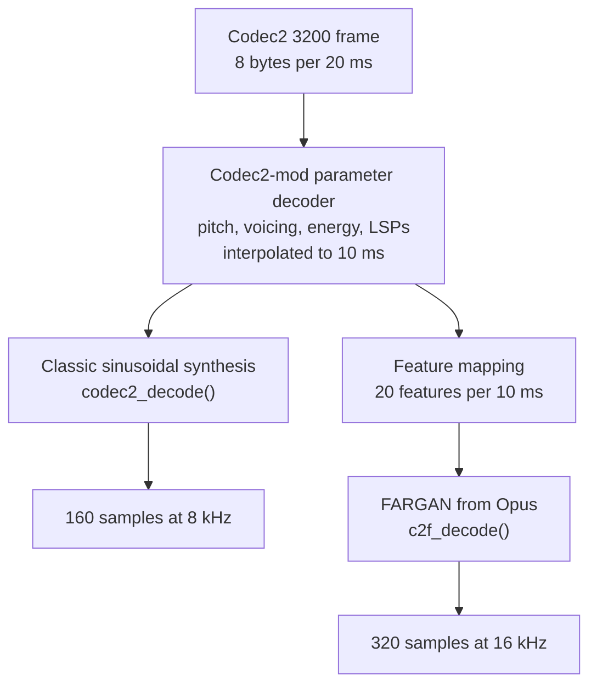

# Codec2-mod-neural

Codec2 3200 bps bitstream-compatible neural (FARGAN) synthesizer.

This library decodes ordinary Codec2 3200 frames with a neural vocoder instead
of the classic sinusoidal synthesis. Nothing changes on the transmitting side.
The bitstream is untouched and any classic Codec2 decoder still works on it.
Only the receiver gets better audio, at 16 kHz instead of 8 kHz.

## How it works




The parameter decoding is exactly the one `codec2_decode()` does. FARGAN only
replaces the final synthesis step. It never sees anything a normal Codec2
receiver would not have.

## The model

* [FARGAN architecture from Opus](https://arxiv.org/pdf/2405.21069), unchanged, 817,525 parameters
* trained with the Opus recipe on the [Opus speech corpus](https://media.xiph.org/lpcnet/speech/tts_speech_negative_16k.sw), 400 epochs plus 50 adversarial epochs
* checkpoint fargan_adv_50.pth, details in model/MODEL.txt
* the .pth file is attached to the GitHub releases, it is not stored in the repository
* Opus describes FARGAN as about 0.6 GFLOPS
* measured: about 1.6 ms of CPU time per 20 ms frame on one x86-64 core (Xeon 2.1 GHz, AVX2), about 8 percent of that core

The ARM64 build uses NEON automatically. It was checked under emulation only,
speed on real ARM hardware is still to be measured.

## Building

Codec2-mod has to sit next to this repository, or point C2MOD_DIR at it.

    git clone https://github.com/M17-Project/Codec2-mod.git
    git clone https://github.com/M17-Project/Codec2-mod-neural.git
    cd Codec2-mod-neural
    cmake -B build
    cmake --build build

CMake options:

* `C2MOD_DIR` - path to the Codec2-mod sources, default ../Codec2-mod
* `C2F_AVX2` - use AVX2 and FMA on x86-64, default ON. Turn it OFF for CPUs older than Intel Haswell (2013) or AMD Excavator (2015)
* `C2F_TOOLS` - build the command line tools, default ON

If the parent CMake project already has a target called `codec2_mod`, that one is
used and Codec2-mod is not built a second time.

## Trying it

    sox speech.wav -r 8000 -c 1 -t raw -e signed -b 16 speech.raw
    build/c2enc speech.raw speech.c2
    build/c2f_decode speech.c2 speech_fargan.wav -b

`c2enc` is the plain Codec2-mod encoder. `c2f_decode` writes a 16 kHz WAV file and
with -b prints how much CPU time the decoding took.

## Using it in an application

Include `c2fargan.h` and link the c2fargan library. The whole API:

```C
    c2f_decoder *c2f_create(void)
    void c2f_reset(c2f_decoder *dec)
    void c2f_decode(c2f_decoder *dec, int16_t *pcm, const uint8_t *bits)
    void c2f_decode_float(c2f_decoder *dec, float *pcm, const uint8_t *bits)
    void c2f_destroy(c2f_decoder *dec)
```

* `c2f_decode` takes one 8 byte Codec2 3200 frame and returns 320 samples at 16 kHz. It is used in place of codec2_decode
* call `c2f_reset` at the start of every new transmission
* for static allocation use `c2f_size()` and `c2f_init()` instead of `c2f_create()`
* the output is 10 ms behind the classic decoder and the first 10 ms of a transmission are silent
* an application whose audio path runs at 8 kHz can resample the output down and still gain most of the improvement

### Other build systems (qmake, Makefile)

Add these sources:

    src/c2fargan.c
    src/c2f_features.c
    model/fargan_data.c
    third_party/opus/dnn/fargan.c
    third_party/opus/dnn/nnet.c
    third_party/opus/dnn/nnet_default.c
    third_party/opus/dnn/parse_lpcnet_weights.c

Include paths: include, src, model, third_party/opus, third_party/opus/dnn,
third_party/opus/celt, third_party/opus/include, and the Codec2-mod inc folder.
Define `SUPPRESS_PERF_WARNINGS`. On x86-64 add `-mavx2 -mfma`. Link with libm.

The application also needs the Codec2-mod sources, once. If it already
compiles them for the classic decoder, do not add them again.

## Checking the C code against PyTorch

    python3 tests/compare_with_python.py fargan_adv_50.pth speech.c2

It decodes the same file with the C library and with the PyTorch model and
checks the timing (160 samples, the 10 ms offset) and the log spectral
distance. On speech the distance is 0.5 to 1.5 dB. The waveforms themselves are
not identical because FARGAN is autoregressive and tiny numerical differences
grow over time. The PyTorch model even adds a little noise inside the network,
and that alone changes its own waveform about as much. The features are bit
identical to the ones the model was trained on.

## Repository layout

| path | what |
|---|---|
| include/c2fargan.h | public API |
| src | decoder and Codec2 to feature mapping |
| model | generated FARGAN weights (fargan_data.c and .h) and MODEL.txt |
| third_party/opus | FARGAN runtime copied from Opus, BSD-3-Clause |
| tools | c2f_decode and c2enc |
| tests | comparison with the PyTorch reference |
| training | everything needed to train a new model, see training/README.md |

## License

LGPL-2.1, the same as Codec2 and Codec2-mod, see LICENSE.
The files in third_party/opus are BSD-3-Clause, Copyright Xiph.Org Foundation
and contributors, see third_party/opus/COPYING.

## Credits

* FARGAN and the training recipe: Opus, Xiph.Org Foundation
* Codec2: David Rowe VK5DGR, and contributors
* Codec2-mod: Wojciech Kaczmarski SP5WWP, Silvano Seva IU2KWO, M17 Foundation
